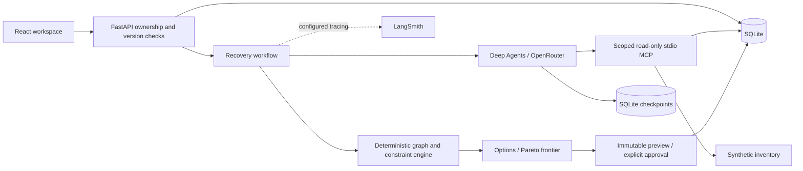

# Implementation and requirement map

The primary specification is the retained RouteRescue implementation blueprint in `docs/source`. SQLite is the only persistence technology. All transport inventory, fares, status events, transfer timings and hotel policies are synthetic.

## Coverage

| Requirement | Implementation |
|---|---|
| Hero A/B/C/D scenario | Explicit fixture legs and ledger, independent expected outcomes |
| Trip impact graph | Typed dependency edges, cycle rejection, topological timing propagation, textual UI |
| Flight/train/hotel disruptions | Scenario-specific events, fixture inventory and API/browser tests |
| Cash, timing, transfer, baggage, accessibility | Pure deterministic evaluation; unknown required facts never feasible |
| Recovery frontier | Nondominated budget/time relaxations; unknown/impossible candidates excluded |
| Second disruption | A unavailable, old results superseded, old previews rejected |
| Versioned constraint changes | Optimistic version check, revalidation, separate approval |
| Receipt | Before itinerary, legs, cash ledger, refunds separate, booking actions, evidence, expiry, versions, JSON/print |
| Human approval | Explicit acknowledgement, immutable hash, owner/version/expiry checks |
| Idempotence | Event keys, run input keys, confirmation keys, serialized SQLite transactions |
| Progress and observability | Persisted stages, UI polling, SSE, audit history, LangSmith spans |
| Deep Agents + MCP | Actual harness, eight scoped read-only tools, actual stdio integration tests |
| Low spend | Free router default, paid opt-in, 6 model calls / 12 tools / 90-second default deadline |
| Persistence | Application records and agent checkpoints in SQLite |
| Evaluation | 30 labelled evaluator cases × 3; API/approval/version tests separately |
| UX | White background, local fonts, responsive layout, keyboard dialog support |
| Delivery | Locked dependencies, run/reset/test/package scripts, README and demo script |

## Design decisions and limits

- Structured intake is limited to the explicit demo corridor and date. Other locations/dates are rejected rather than silently matched to false fixtures.
- One stdio MCP server hosts logical context/options groups. Its process is scoped to an owner and trip and exposes no SQL, arbitrary URL, purchase or cancellation tools. Provider credentials are excluded from its environment and `.env` loading.
- The tested `langchain-mcp-adapters` API is pinned. It is not mixed with the newer beta `langchain.mcp` API.
- A single Deep Agent supervisor performs bounded research. Optional specialist subagents are omitted to reduce model spend. Planning and context management remain supplied by Deep Agents.
- The agent must call context, event, inventory and evaluation tools. Its candidate IDs must match actual observed inventory tool results. Code revalidates those records; narrative never controls feasibility.
- Malformed agent output gets one correction attempt within the same thread's budget. Provider/model/timeout failure produces an explicit failed recovery in OpenRouter mode. There is no silent fixture fallback.
- B/C/D intermediate legs were added to make the original fixture totals verifiable. C checks in before the hotel cutoff, then takes a longer evening transfer and misses the workshop start at 19:30.
- Only cash and deadline can be relaxed via frontier buttons. Unknown accessibility, impossible transfers and missing prices cannot be relaxed into feasibility.
- Multi-traveller ledger components scale per traveller, including room allowance and contingency. This is a conservative synthetic cost convention, not real provider pricing.
- Candidate generation queries editable SQLite demo inventory, not global live airline inventory. Admin changes and reported departure times alter the result set.
- Refresh uses persisted results. Interrupted runs become failed at startup and can be retried. Checkpoints are stored, but automatic continuation of interrupted external model calls is not implemented.
- Five accounts and eight trips are seeded once. Passwords use salted scrypt; session tokens are stored hashed and expire after 12 hours. Logout/account disable revokes sessions; failed logins are throttled. Role/ownership checks protect admin and traveller APIs. Public hosting still needs replacement demo credentials, TLS and production operations.
- No live purchase, refund, cancellation, notification, provider scraping, inbox parsing or monitoring is implemented. Provider handoff is an actionable checklist.
- The exact presentation template, team details and video/submission URLs are not available. Eight-slide content and a four-minute script are provided; no completed team-specific deck or video is claimed.

## Official references

- [Deep Agents](https://docs.langchain.com/oss/python/deepagents/quickstart)
- [LangChain MCP integration](https://docs.langchain.com/oss/python/langchain/mcp)
- [LangSmith tracing](https://docs.langchain.com/langsmith/trace-with-langchain)
- [OpenRouter free router](https://openrouter.ai/openrouter/free)

Installed versions are locked and tested. Free-model availability and rate limits can change.
