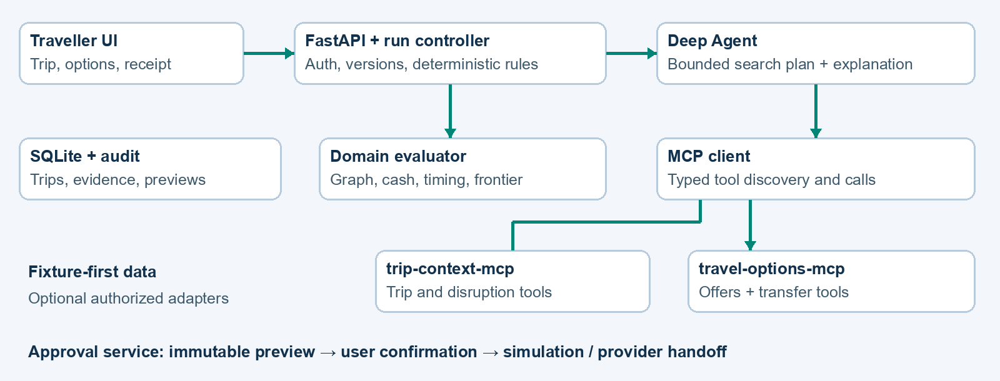

# RouteRescue AI
SAVE THE PURPOSE OF THE TRIP

Implementation blueprint | DEVHOST 2026 | PS 4.1

A Deep Agent + MCP recovery system that repairs connected travel plans around the traveller’s must-reach commitment.

## The pitch

A cancelled flight can also break an airport pickup, a hotel check-in and a prepaid local experience. RouteRescue builds a dependency graph of the trip, identifies the cascade, and produces a recovery plan that respects arrival time, immediate spending capacity and accessibility. If nothing works, it explains the smallest explicit change that would make a plan possible.

## The three signature features

- Trip Impact Graph: show exactly which bookings are directly disrupted, at risk, or still usable, with reasons.

- Recovery Frontier: when constraints conflict, show concrete trade-offs such as “INR 800 more” or “45 minutes later,” without silently changing the traveller’s limits.

- Recovery Receipt: one evidence-backed itinerary with a cash ledger, changes to existing bookings, next actions and a clear approval boundary.

## Status and assumptions

This is a proposed implementation, not a claim that a prototype already exists. Assume a four-person team and a 48-hour build; the schedule can be compressed by removing optional integrations. “Deep Agent” is interpreted as LangChain Deep Agents. Primary demo data are seeded and visibly simulated. No claim of worldwide novelty or guaranteed selection is made.

Prepared 21 October 2026. Based on the supplied implementation guide and the exact eight-slide PPT template. Team details and submission links remain for the team to supply.

# 01 / What to retain—and improve
FROM A GENERAL RECOVERY ASSISTANT TO A DEMONSTRABLE PRODUCT

The supplied guide already makes good choices: deterministic feasibility checks, a narrow MCP interface, human approval, source labels and an offline simulator. Preserve these. The improvement is a sharper product hypothesis and a demo that proves it.

| Existing foundation | Proposed improvement |
| --- | --- |
| Search and rank alternate routes | Repair a trip graph, including pickup, hotel and local activity dependencies. |
| Budget and arrival constraints | Separate cash needed now from uncertain refunds; evaluate arrival at the actual commitment location. |
| No feasible option → ask user | Compute a Pareto frontier of minimum budget/deadline relaxations. |
| Weighted option score | Filter hard constraints first; show interpretable cost, arrival and transfer slack. |
| Agent trace and audit log | Show a concise decision trace and evidence receipt, without exposing hidden reasoning. |
| Generic implementation roadmap | Specify one corridor, exact fixtures, acceptance tests and an eight-slide submission story. |

## One concrete correctness fix

The original guide’s illustrative evaluator can classify an option with unknown cost as feasible because it only rejects known prices above budget. Replace binary feasibility with FEASIBLE, INFEASIBLE and NEEDS_VERIFICATION. Unknown cost or required accessibility must never enter the confirmed-feasible set.

## Scope that fits the problem statement

Implement flight cancellation, train delay and hotel cancellation as event types against the same graph. Make the flight-cancellation scenario the polished demonstration; exercise the other two through smaller fixtures. Identify affected bookings and export actionable recovery itineraries in all cases.

## Positioning

Lead with “save the trip’s purpose,” then prove the graph, frontier and receipt. Deep Agents and MCP are implementation choices, not the novelty claim. The differentiation is the combined workflow; validate competitive originality before using claims such as “first” or “only.”

# 02 / The hero scenario
ONE REGIONAL CORRIDOR; A COMPLETE RECOVERY STORY

All services, fares, policies and travel durations below are synthetic fixtures, not current travel advice. Scenario date: 15 November 2026; all displayed times are IST. One traveller is in Mangaluru at 08:00. Their flight to Bengaluru is cancelled.

| Trip item | Fixture and consequence |
| --- | --- |
| F1: flight | 09:00 departure; 10:00 arrival; event marks this booking DISRUPTED. |
| P1: prepaid pickup | 10:45 airport pickup; depends on F1; needs rescheduling or cancellation review. |
| H1: hotel | Check-in cutoff 18:00; INR 2,000 prepaid; late arrival risks a no-show under the fixture policy. |
| E1: local cultural workshop | 19:30 start; traveller requires venue arrival by 19:00; INR 1,200 prepaid. |
| Constraints | INR 5,000 available for new spending; one traveller; bus and air allowed; one standard bag. |

## Candidate set used in the demonstration

| Option | Cash now | Venue arrival | Decision |
| --- | --- | --- | --- |
| A: bus + local transfers | INR 3,200 | 18:15 | Feasible; cheapest; preserve workshop. |
| B: flight + local transfers | INR 5,800 | 17:00 | Reject: INR 800 over budget. |
| C: later bus + transfers | INR 2,600 | 19:45 | Reject: 45 minutes late. |
| D: apparent cheap connection | INR 2,900 | 18:00 claimed | Reject: only 10 minutes available for a required 45-minute transfer. |

Option A ledger: INR 300 to departure terminal + INR 2,300 intercity bus + INR 400 local transfer + INR 200 fixed demo contingency = INR 3,200. Terminal arrival 08:45; boarding buffer 15 minutes; bus departs 09:15 and arrives 16:45. Local transfer reaches hotel at 17:15; check-in dwell 30 minutes; onward travel 30 minutes reaches venue at 18:15.

The receipt says: replace F1, review unused P1, retain H1, preserve E1. No hotel confirmation or refund is invented. With arrival at 17:15, the fixture check-in cutoff is met; operational changes still require revalidation.

# 03 / The memorable second disruption
THE RECOVERY FRONTIER MAKES THE AGENT USEFUL WHEN THE ANSWER IS “NO”

After the user sees A, inject a second fixture event: the 09:15 bus is unavailable. The original INR 5,000 / 19:00 constraints now have no feasible plan. Invalidate A and any preview attached to it; do not keep showing it as selectable.

| Available trade-off | Explicit change | Traveller decision |
| --- | --- | --- |
| B: arrive at 17:00 | Increase cash limit by INR 800 | Preserves the original commitment time. |
| C: arrive at 19:45 | Extend deadline by 45 minutes | Misses the workshop start; proceed only if that loss is accepted. |
| Neither is acceptable | Keep existing constraints | Return NO_FEASIBLE_PLAN with operator handoff and affected-booking checklist. |

## How to calculate it

For each otherwise valid candidate, compute delta_budget = max(0, cash_required − budget) and delta_time = max(0, venue_arrival − deadline). Remove a candidate if another needs no larger relaxation on either dimension and is strictly better on at least one. Return the remaining nondominated candidates as the frontier.

Only budget and deadline are relaxable in this MVP. Accessibility, identity, location continuity and impossible transfers remain hard checks. A candidate with unknown required facts is NEEDS_VERIFICATION and cannot claim to be a valid frontier recommendation.

## Interaction contract

The traveller chooses “Increase budget to INR 5,800,” “Allow arrival at 19:45,” or “Keep my limits.” Save the change as constraint_version + 1, rerun validation and show the new consequences. Choosing a relaxed constraint is separate from approving a booking action.

## Why it matters

The system turns a vague failure into a decision the traveller can make. It also demonstrates adaptive planning: the agent must react to a changed option set, preserve non-negotiable constraints and explain a new result using tool evidence.

Do not label the workshop “saved” for C. Do not make promises about ticket availability. The interface should show “simulated feasible under fixture assumptions” during the demo.

# 04 / Product flow and screens
A TRAVELLER SHOULD UNDERSTAND THE RESULT IN SECONDS

| Screen | Required content |
| --- | --- |
| 1. My trip | Timeline, connected bookings, must-reach location/time, cash limit, required needs; load demo or enter structured trip. |
| 2. Disruption | Source and time; mark event SIMULATED; highlight impacted graph nodes and explain each dependency. |
| 3. Recovery progress | Verifying event → assessing bookings → searching → checking constraints → preparing receipt. Show tool status, not private reasoning. |
| 4. Compare options | Top feasible plan plus alternatives; cash now, venue arrival, transfer slack, uncertainty and rejected-option reasons. |
| 5. No feasible plan | Budget/time frontier with exact deltas; explicit constraint-change buttons. |
| 6. Recovery receipt | Before/after itinerary, KEEP / CHANGE / REVIEW booking actions, cost ledger, evidence and official-provider handoff. |

## Receipt contents

- Run ID, trip version, constraint version, option version, generated_at, data mode and expiry.

- Each leg’s locations, departure/arrival times with timezone, dwell time, transfer assumptions and provider reference when present.

- Immediate payable amount, fixed demo contingency, known change fees and uncertain refunds displayed separately.

- Booking-level actions: traveller action, deadline, dependency, status and evidence. “Draft hotel late-arrival request” remains a draft.

- Decision explanation: which constraints passed, which alternatives failed, which facts need verification.

## Usability requirements

Use text labels as well as colours. Keep the receipt readable on a phone; allow print/download and copyable action steps. A route map is optional because the impact graph and timeline communicate the core idea more directly.

## Intake boundary

Start with a structured form and fixture JSON. Booking-email/PDF extraction is a stretch feature: extracted dates, locations and policies require user confirmation before entering the trip graph. Do not spend the core build on inbox integration.

# 05 / Architecture
DEEP AGENT PLANS; MCP EXPOSES CAPABILITIES; CODE ENFORCES RULES

React + Vite frontend calls FastAPI. The backend owns authentication, trip versions, recovery state and the deterministic evaluator. The Deep Agent plans bounded searches and explains returned evidence. Two custom MCP servers expose narrow tool groups. SQLite stores demo state; PostgreSQL is a later deployment option.

| Boundary | Responsibility |
| --- | --- |
| trip-context-mcp | Read owned trip; verify fixture disruption; compute impacted bookings from typed dependencies. |
| travel-options-mcp | Search air, ground and lodging fixtures; obtain transfer estimates; revalidate selected offers. |
| Domain services | Assemble candidate paths, calculate cash and timing, filter constraints, compute frontier and rank. |
| Action service | Create versioned previews; validate user confirmation; simulate completion or provide booking handoff. |
| Persistence | Trip/events, evidence, recovery runs, options, previews, constraint revisions and audit events. |

These are custom application servers to implement, not existing official airline MCP servers. MCP standardizes the tool boundary; provider APIs or fixtures supply the data. Use local stdio processes for the demo; select and test an authenticated transport before remote deployment. [3]

A single deployable MCP process with two logical tool groups is an acceptable time-saving fallback. Two servers are useful for isolating private trip context from external search credentials; more servers do not improve the product automatically.

# 06 / Agent orchestration
A BOUNDED WORKFLOW WITH VISIBLE EVIDENCE

LangChain Deep Agents provides a harness for multi-step work, context management and delegation. Configure planning and only the specialist behavior actually required; pin a tested dependency set instead of assuming a tutorial’s defaults. [1]

| Role | Inputs and allowed work |
| --- | --- |
| Recovery supervisor | Trip ID and constraints; plan searches, merge normalized candidates, request evaluation and explain results. |
| Transport specialist | Air/ground search and transfer tools; return candidate IDs and evidence, not feasibility claims. |
| Stay specialist (optional) | Hotel alternatives and policy facts when a hotel is impacted; otherwise skip. |
| Deterministic services | Graph impact, path joining, cost arithmetic, hard checks, frontier and ranking. No LLM authority to override these. |

## Execution sequence

RECEIVED → CONTEXT_READY → IMPACT_ANALYZED → SEARCHING → VALIDATED → OPTIONS_READY or NO_FEASIBLE_PLAN → PREVIEW_READY → USER_CONFIRMED → SIMULATED_COMPLETE or HANDOFF_READY. Use FAILED or NEEDS_INPUT for incomplete context; mark prior results SUPERSEDED when their inputs change.

## Run limits

Start with at most two read-only specialist searches in parallel, 12 external tool calls, two replan cycles and a 25-second search deadline per run. These are engineering defaults, not measured performance. Cancel overdue work and return an honest partial result. Persist checkpoints so a UI refresh does not start duplicate work.

## Structured supervisor output

Return {run_id, trip_version, constraint_version, impacted_booking_ids, candidate_ids, evaluation_ids, recommended_option_id|null, frontier_ids, explanation_evidence_ids, next_action}. The UI loads times and prices from validated records, never from narrative text.

## Integration spike before full build

Connect one MCP fixture tool, discover it with the selected client adapter, invoke it through the agent, validate the response and record a trace. Current LangChain documentation describes MCPAdapter and flags its API as beta; lock a verified version and avoid mixing old and new client examples. [2]

No model credentials: run the deterministic demonstration and label agent planning unavailable. No network: use fixtures; an offline demo is not evidence of live model or provider behavior.

# 07 / MCP contracts and provider strategy
TYPED RESULTS, EXPLICIT PROVENANCE

| Server / tool | Input → output |
| --- | --- |
| context / get_trip | trip_id → bookings, dependencies, constraints, version; enforce owner access. |
| context / verify_event | event_id → status, service/date match, evidence; weather alone is insufficient. |
| context / get_impacts | trip_id, event_id → impacted IDs, dependency paths, reasons and status. |
| options / search_transport | locations, date window, passengers, modes → normalized offers. |
| options / search_stays | destination, dates, needs → hotel candidates with check-in facts. |
| options / get_transfer | from, to, depart_at → duration, source, validity and assumptions. |
| options / revalidate_offer | offer_id, expected_version → current snapshot or CHANGED/UNAVAILABLE. |

## Shared envelope

Every result carries schema_version, request_id, source_id, fetched_at, valid_until, data_mode, availability_state, evidence_ids and typed errors. Distinguish LIVE, CACHED, STALE and SIMULATED. Reject malformed records; do not replace missing values with zero. Money uses integer minor units plus currency; time uses offset-aware timestamps normalized to UTC.

## Data integration order

| Capability | MVP | Optional live path |
| --- | --- | --- |
| Flight/train/bus offers | Seeded JSON with versioned inventory | Provider-authorized search/status adapters after access and coverage checks. |
| Hotels and policies | Seeded availability + explicit fixture rules | Authorized hotel search adapter; policy facts tied to exact rate. |
| Transfers | Curated fixture durations and buffers | Google Routes adapter after account, coverage and quota checks. [4] |
| Booking or notifications | Preview and simulated result only | Separate authorized transactional integration after MVP. |

Do not assume a flight API also exposes rail inventory, hotel policy changes or ticketing. No rail scraping dependency. Keep the core evaluation reproducible using fixtures. Weather adds little to the main proof and can be deferred.

Server enforcement: tenant ownership, narrow tool allow-list, input/output validation, per-run request budgets and credential isolation. Treat retrieved descriptions as untrusted content. Tool descriptions and model prompts do not replace access checks.

# 08 / Graph and constraint algorithms
BUILD THE CORE AS TESTABLE PURE FUNCTIONS

## Trip dependency graph

Represent bookings and the must-reach commitment as nodes. Store typed edges: ARRIVAL_BEFORE, TRANSFER_TO, CHECKIN_BEFORE and REQUIRES_BOOKING. Include location, time windows, dwell duration, required needs and evidence references. A hotel cancellation affects accommodation; it does not automatically cancel the flight or the workshop.

Start from the disrupted node, traverse outgoing dependencies and recompute each rule. Mark a descendant AT_RISK only if its rule fails or required facts are unknown; reachability alone is insufficient. Keep unaffected nodes visible. With the small acyclic itinerary graph, a topological pass is O(V+E); reject cycles on intake.

## Feasibility

- Cash: cash_required = new payable fares + local transfers + payable change fees + chosen contingency. Do not subtract a refund that has not settled and become available to spend.

- Time: previous arrival + dwell + transfer duration + boarding buffer ≤ next departure; include last-mile travel to the commitment location.

- Needs: passenger count, availability, allowed mode, baggage and required accessibility must all be verified. Unknown mandatory facts yield NEEDS_VERIFICATION.

- Policy: check hotel cutoff, booking validity and other fixture rules; record deadlines for actions that require operator confirmation.

## Ranking

Filter first. Rank FEASIBLE options lexicographically by user-selected preference: default lowest cash, then earliest venue arrival, then greatest minimum transfer slack, then fewest booking changes. Offer an “earliest arrival” preference that swaps the first two. Use stable option_id as the final tie-breaker. Avoid an opaque blended “confidence” number.

## Bounded candidate generation

Normalize a maximum of 20 offers per mode; join only location-compatible legs within the time window; allow at most two intercity legs and essential local transfers. Cap assembled candidates at 100. Report search scope explicitly: “No feasible option in the searched set,” not “No possible route exists.”

Frontier computation is O(n²) at this small cap. Cache transfers by locations/time bucket, but preserve source timestamps and invalidate when policy requires a fresh estimate.

# 09 / Data model and application API
VERSION EVERY DECISION THAT CAN BECOME STALE

| Entity | Essential fields |
| --- | --- |
| Trip / ConstraintSet | id, owner_id, version, venue_location, latest_arrival, cash_limit_minor, currency, needs, preferences. |
| Booking / Dependency | booking_id, type, provider_ref, location/time windows, policy_evidence_id; from_id, to_id, rule, parameters. |
| DisruptionEvent | id, service/booking_id, occurred_at, received_at, source_event_id, event_type, evidence_id. |
| Offer / Evidence | id, version, legs, payable components, availability, source, fetched_at, expiry, data_mode. |
| RecoveryRun / Evaluation | id, input_versions, state, candidate IDs, reason codes, cash totals, arrival, slack, trace_id. |
| ActionPreview / Audit | id, snapshot_hash, option_version, expiry, user decision, idempotency_key, result_state; actor/time/references. |

## Minimal endpoints

POST /trips; GET /trips/{id}; POST /trips/{id}/events; POST /trips/{id}/recoveries; GET /recoveries/{id}; GET /recoveries/{id}/events for progress; PATCH /trips/{id}/constraints with expected_version; POST /options/{id}/preview; POST /previews/{id}/confirm; GET /recoveries/{id}/receipt.

Scope all reads and writes to the authenticated owner. Preview and confirm endpoints must reject mismatched trip/option versions. The simulator endpoint is restricted to demo mode and never presented as a live-provider webhook.

## Reason codes the UI can explain

OVER_BUDGET; ARRIVES_LATE; TRANSFER_TOO_SHORT; REQUIRED_FACT_UNKNOWN; ACCESSIBILITY_UNVERIFIED; OFFER_EXPIRED; OFFER_UNAVAILABLE; POLICY_CONFLICT; INPUT_VERSION_CHANGED; NO_FEASIBLE_PLAN; PROVIDER_TIMEOUT.

## Suggested repository

apps/web/ — screens and receipt; apps/api/ — auth, endpoints and run state; agent/ — supervisor, prompts and specialist definitions; mcp/context/ and mcp/options/ — servers; providers/ — fixtures and live adapters; domain/ — graph, paths, feasibility, frontier and ledger; fixtures/ — versioned scenarios; tests/ — unit, contract and end-to-end; docs/ — demo script and measured results.

Use SQLite for the local build and a persistent volume. Store secrets outside source control. Log references and reason codes rather than booking documents or credentials.

# 10 / Approval, staleness and failure behavior
A PLAN IS NOT A CONFIRMED BOOKING

## Approval sequence

Select option → revalidate → build immutable preview → explicit user confirmation → server checks ownership, expiry and versions → simulated completion or provider handoff. Bind confirmation to option ID, legs, prices, action list and constraints through a server-generated snapshot hash. A price or inventory change invalidates the preview.

MVP confirmation says “Confirm this recovery plan,” not “Book now.” A handoff link is not evidence of purchase. Display “Booking pending with provider” until the traveller supplies confirmation or a future authorized integration verifies success. Never cancel the old booking merely because a new plan was selected.

| Failure injected | Required result |
| --- | --- |
| Repeated cancellation event | Deduplicate source_event_id; do not start duplicate active recovery runs. |
| Offer changed after selection | Invalidate preview; show changed cost/status and regenerate alternatives. |
| Missing price or accessibility | NEEDS_VERIFICATION; exclude from feasible recommendations. |
| Provider outage | Return partial coverage and known limitations; demo fallback requires a visible mode change. |
| Conflicting status evidence | Show conflict; do not present cancellation as verified. |
| Malformed agent response | One structured retry; then deterministic explanation from validated results. |
| Repeated confirmation | Same idempotency key returns the existing simulated outcome. |
| Store unavailable | Do not confirm actions that cannot be persisted. |
| Unknown external outcome (future) | Query provider status; never blindly retry a purchase. |

## Privacy boundary

Synthetic traveller data for judging. No passport, card or inbox access is required. If real bookings are later imported, minimize retained fields, redact logs and offer deletion. Private trip context must not be exposed through a public MCP endpoint.

## Source discipline

Narrative explanations must reference evidence IDs. A predicted delay, forecast or cached schedule is not a confirmed cancellation or seat. Keep availability status distinct from whether the source is live. Show timestamps and expiry directly on the receipt.

# 11 / Build plan and delivery gates
48 HOURS; CORE FIRST; OPTIONAL WORK HAS A STOP RULE

| Time | Deliverable and exit gate |
| --- | --- |
| 0–4 h | Agree contracts and fixture truth tables. Run one MCP tool through the agent. Lock dependencies. |
| 4–12 h | Graph, cash ledger, timing checks, candidate assembly and frontier; deterministic hero scenario passes. |
| 12–20 h | Two logical MCP groups, normalized evidence, bounded agent run and persisted recovery state. |
| 20–30 h | Intake, impact graph, options, no-plan frontier and downloadable receipt. Full path works. |
| 30–36 h | Versioned preview, second disruption, failure handling and train/hotel scenarios. |
| 36–42 h | Acceptance suite, timed runs and optional single live read-only adapter only if core is stable. |
| 42–48 h | Freeze features; rehearse, record ≤4-minute demo, fill exact template, verify links and package repo. |

## Suggested work ownership

Member 1: domain model, fixtures and evaluation. Member 2: MCP and agent orchestration. Member 3: frontend and receipt. Member 4: integration, tests and presentation. Establish schemas together before dividing work. With fewer members, use one MCP process and omit optional specialist agents.

## Must ship

One complete flight recovery; impact graph; deterministic budget/time/transfer checks; frontier after second disruption; source-labelled receipt; simulated approval; train-delay and hotel-cancellation test fixtures; reproducible launch instructions.

## Cut first

Live booking, payments, email parsing, real-time inbox monitoring, notifications, weather, voice, multi-currency conversion and broad national coverage. None is required to prove the core recovery flow.

## Development commands to provide in the eventual repository

One documented environment setup, one fixture seed command, one command to launch services, one test command and one reset-demo command. Include .env.example without secrets and a fixture-only mode that never calls a provider.

Dependency gate: test tool discovery, schema parsing and one complete agent run on the exact locked versions. The document is a build specification; code sketches or architecture diagrams are not substitute evidence of a working prototype.

# 12 / Evaluation that judges can inspect
REPORT MEASURED RESULTS; KEEP TARGETS LABELLED

| Test | Expected outcome |
| --- | --- |
| Hero cancellation | F1 disrupted; P1 needs review; A feasible; B/C/D rejected for the stated reasons. |
| Second disruption | A invalidated; frontier contains B (+INR 800) and C (+45 min); no feasible option under old constraints. |
| Unknown fare | NEEDS_VERIFICATION; never a zero-cost feasible route. |
| Missing required accessibility | NEEDS_VERIFICATION, even when other constraints pass. |
| Train delay | Recompute dependent transfer; retain independent hotel if its cutoff still holds. |
| Hotel cancellation | Find substitute lodging within cash/location rules; keep valid transport bookings. |
| Boundary and timezone | Exact deadline accepted; one minute late rejected; UTC comparisons agree with rendered IST. |
| Refund pending | Cash limit uses gross payable costs; projected refund remains separate. |
| Stale preview / duplicate event | Reject old version; duplicate event produces no duplicate outcome. |
| Untrusted provider text | “Ignore budget” in description has no effect on evaluator or action authorization. |

## Evaluation protocol

Create 30 labelled synthetic scenarios: ten primary recovery cases, ten constraint/missing-data cases, and ten failure/version cases. Run each three times with the same fixture truth, record agent/tool trace and compare to an independently maintained expected-outcome table. Count each scenario once for correctness; use all 90 runs for latency and variability.

| Metric | Proposed acceptance target |
| --- | --- |
| Hard-constraint validity | 100% of recommended options satisfy fixture truth; zero unknown mandatory facts passed. |
| Impact detection | Report precision/recall against labelled affected bookings; target ≥95% each. |
| Time to options | Report p50 and p95; target p95 ≤30 seconds for fixture-backed runs with the selected model. |
| Source/approval behavior | 100% labelled outputs; zero stale or unauthorized confirmations in negative tests. |
| Usability | At least 4 of 5 test users identify cash, venue arrival and next action unaided. |

Compare against a deterministic single-mode cheapest-route baseline on the same fixtures. Measure commitment preservation and downstream booking issues detected. Do not claim percentage time or money savings without measured comparison. A small synthetic suite establishes demo correctness, not real-world reliability.

# 13 / Business value and scaling
A FOCUSED CUSTOMER HYPOTHESIS

## Initial buyer

Test with small tour operators and travel desks managing multi-booking regional trips. Their potential value is reduced recovery handling time and fewer missed downstream actions. Travellers are the end users; local hotels, guides and cultural venues may benefit when recoverable bookings are retained. These benefits require validation.

## Commercial hypothesis

Start with a B2B subscription including a monthly recovery allowance, then an additional per-case fee. Keep ranking independent of commissions. Interview five operators and five travellers before claiming willingness to pay; ask about the last disruption, actions taken, handling time and preventable losses.

## Illustrative unit economics—not actual vendor prices

Assume INR 25 revenue allocated to one recovery case, INR 4 for model usage, INR 2 for data calls and INR 1 for hosting allocation. Contribution before support, sales, tax and overhead is INR 18 per case (72%). At 1,000 cases/month the assumptions imply INR 25,000 revenue and INR 7,000 variable cost. Replace all assumptions with bills and interview findings before pitching margins as evidence.

Instrument tokens, tool calls, retries and cached responses per run. Maintain a team-approved demo spend cap; stop optional live calls when the cap is reached. Costs depend on selected models, provider contracts and usage; no paid vendor tier is essential to the fixture prototype.

## Scaling path

| Stage | Expansion gate |
| --- | --- |
| Hackathon | One corridor; synthetic data; locally reproducible recovery. |
| Read-only pilot | One authorized provider; documented coverage; real-user consent and measured correctness. |
| Multi-operator pilot | Tenant isolation, queues, rate limits, per-provider circuit breakers and support handoff. |
| Transactional service | Provider agreements, verified inventory, auditable authorization and reliable reconciliation. |

## Market slide discipline

Use a bottom-up opportunity formula: reachable operators × validated monthly price. Do not invent a market-size statistic. Example planning assumption: 100 reachable operators × INR 2,000/month = INR 2 lakh monthly potential revenue at full conversion, not a forecast or evidence of demand.

# 14 / Exact eight-slide PPT mapping
PRESERVE THE SUPPLIED TEMPLATE’S STRUCTURE AND SLIDE COUNT

| Slide / required heading | Ready-to-adapt content and visual |
| --- | --- |
| 1 / Team details | RouteRescue AI — Save the purpose of the trip. PS 4.1. Fill team name, four member fields, leader email/phone and college. |
| 2 / Problem Statement | “One cancellation can break the whole trip.” Show flight → pickup → hotel → workshop. Travellers need a recovery plan within cash and arrival constraints. |
| 3 / Solution Overview | Trip Impact Graph + Recovery Frontier + Recovery Receipt. Example: INR 3,200 recovery, venue arrival 18:15, workshop retained; explicitly label SIMULATED. |
| 4 / Technical Approach | Deep Agents: bounded planning. MCP: typed context/search tools. FastAPI + deterministic graph/constraint engine + SQLite; React UI. Fixture-first providers. |
| 5 / Diagrams/Flow Charts/Visuals | Use the architecture visual. Walkthrough: detect → assess cascade → search → validate → choose → receipt. Branch: no plan → explicit constraint relaxation. |
| 6 / Impacts and Benefits | Show measured constraint validity, impact precision/recall, latency and usability once available. Before measurement, label targets. Explain benefit to traveller and downstream local bookings. |
| 7 / Business Impact & Scalability | Travel-desk subscription hypothesis; cost per run measured from logs; one-corridor → authorized-provider pilot → multi-tenant service. Assumptions are labelled. |
| 8 / Additional links | GitHub, demo video ≤4 minutes, optional deployment. Include tested scope and simulation label in repo/video description. Rename submitted PPT to the team name. |

## Submission discipline

The supplied template explicitly requires exactly eight slides, without adding or removing slides. Keep its headings and structure. Put implementation detail in this document and the repository instead of shrinking the slide text. The user requested an implementation document; this is the content plan for the PPT, not a claim that a completed deck has been produced.

## Selection story

Problem fit is shown by disruption detection and affected bookings. Technical feasibility is shown by bounded MCP calls and deterministic rules. Distinctiveness is shown by the second disruption and recovery frontier. Trust is shown by the receipt. These are proposed presentation priorities, not an official judging rubric.

# 15 / Four-minute demo and judge questions
SHOW A CHANGE OF PLAN, NOT JUST A CHAT RESPONSE

| Time | Action and narration |
| --- | --- |
| 0:00–0:25 | Open trip graph. “The flight is only one piece. This traveller must reach a cultural workshop by 19:00.” |
| 0:25–0:50 | Trigger SIMULATED cancellation. Highlight affected flight/pickup and explain hotel/event checks. |
| 0:50–1:25 | Show concise tool progress. Display A and rejection reasons for B/C/D. Open the INR 3,200 ledger. |
| 1:25–2:05 | Inject bus unavailability. A disappears. Show no feasible plan, +INR 800 and +45-minute frontier. |
| 2:05–2:40 | Choose budget increase; validate B. Show preserved deadline and updated constraint version. |
| 2:40–3:15 | Open receipt and confirm simulated plan. Show actions, source labels and booking still pending. |
| 3:15–3:40 | Open test results and a hotel-cancellation fixture. Report only actual measured results. |
| 3:40–4:00 | Close with buyer hypothesis and next pilot. “We repair the trip around what the traveller cannot miss.” |

## Likely judge questions

- Why an agent? It plans searches, handles missing context and adapts when options fail. Deterministic services still decide affordability and feasibility. Evaluate its contribution against a simple baseline.

- Why MCP? It gives private context and offer adapters stable typed boundaries. It is not a source of free booking inventory or automatic provider access.

- What is actually live? State exactly which adapters are enabled. The default demo is synthetic; labels and timestamps make this visible.

- What happens if nothing works? Show the nondominated budget/time trade-offs, or preserve constraints and hand off with an actionable checklist.

- Can you really book? The MVP validates a plan and simulates approval or hands off. Production booking requires a separate authorized integration.

## Before submitting

Reset fixtures; verify the two-event demo twice; test repo and video links from a signed-out browser; keep video within four minutes; replace team placeholders; label all assumptions and results; keep exactly eight slides; rename the deck to the team name.

# 16 / References and implementation handoff
WHAT IS SOURCED; WHAT IS A PROPOSED DESIGN

## User-provided source material reviewed

RouteRescue_AI_Full_Implementation_Guide (1).docx — existing architecture, scope and implementation baseline.

8b9098b8-b76b-4ccd-80f8-0e383113a405.pptx — eight-slide submission structure, four-minute video limit and team-name filename instruction. Document instructions were treated as reference requirements for this deliverable, not as independent authorization to publish or contact anyone.

## Official technical references checked on 21 October 2026

[1] LangChain, Deep Agents overview. Supports the framework capability summary; the RouteRescue orchestration is a proposed design. https://docs.langchain.com/oss/python/deepagents/overview

[2] LangChain, Model Context Protocol integration. Supports client discovery/integration and the current beta/version caveat. https://docs.langchain.com/oss/python/langchain/mcp

[3] Model Context Protocol, Build an MCP server. Supports typed server tools and client/server separation. Recheck the SDK version at implementation. https://modelcontextprotocol.io/docs/develop/build-server

[4] Google Maps Platform, Routes API overview. Optional routing integration only; no claim of live access, regional transit coverage, price or reserved inventory. https://developers.google.com/maps/documentation/routes/overview

## Original design material in this blueprint

The trip graph schema, recovery-frontier formulation, synthetic scenario, cash ledger, ranking policy, UI, test targets, business assumptions and schedule are proposed for this project. Synthetic numbers are designed to be internally checkable; they are not market evidence or provider quotations.

## First implementation session

- Create the fixture JSON and independent expected-outcome table from pages 02–03.

- Implement evaluate_candidate and compute_frontier as pure functions; prove A/B/C/D outcomes.

- Expose one fixture search through MCP and call it from the Deep Agent.

- Render the recovery receipt from validated records, then add the graph and second disruption.

The strongest final submission is a small working system whose claims can be inspected. This blueprint is designed to make that possible without depending on unconfirmed production travel integrations.
